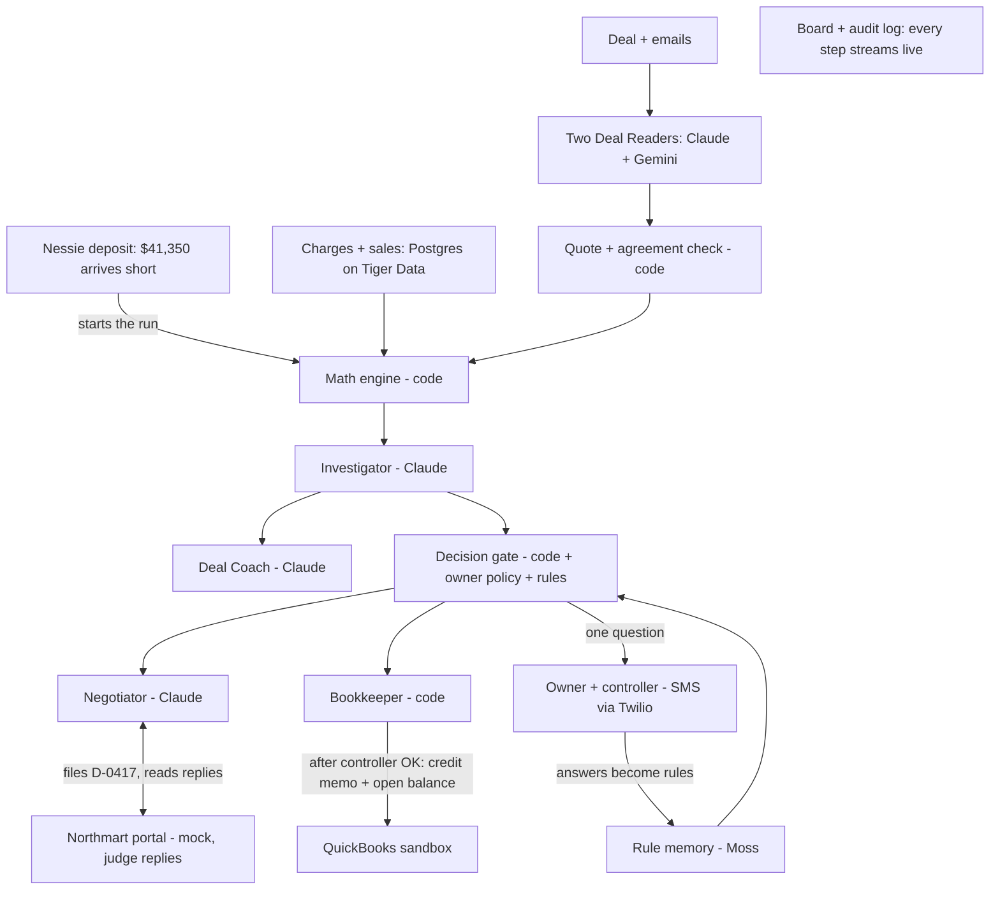

# Clawback

Clawback wins back the money distributors wrongly take from small brands' payments, and never fights a fair charge.
Built at Cal Hacks 13.0. All company names and numbers in the demo are fictional.

- Full plan: [docs/design.md](docs/design.md)
- Team brief: [docs/team/README.md](docs/team/README.md)
- Team guides: [Devank](docs/team/devank.md) · [Rishi](docs/team/rishi.md) · [Manasv](docs/team/manasv.md)
- Decisions log: [DECISIONS.md](DECISIONS.md)

## What it does

Small food brands sell through big distributors, and the distributor pays each invoice short: it takes back
promo allowances, fees and "adjustments" in the same payment. Checking every charge against the signed deal takes
hours nobody has. Clawback is a finance agent that does that check. It:

1. **Reads the deal, the emails and the store sales** with two different AI models, and keeps a term only when
   both agree and its exact sentence is found word for word in the document.
2. **Works out what each charge should have been** in plain, tested code: rates, product lists, dates, unit caps
   across weeks, duplicates of earlier payments.
3. **Disputes the wrong charges with proof** (the clause, the data rows, the math), after predicting the
   distributor's comeback and checking it can answer it.
4. **Accepts the fair ones**, including a charge that looks wrong until the broker's email explains it.
5. **Asks the owner only when the deal is unclear**, once, and saves the answer as a rule so it never asks twice.
6. **Records the result in QuickBooks**, but only after the controller approves.
7. **Rewrites next month's deal** so the same fight doesn't happen again.

### The demo (fictional)

Peak Bar Co. invoices Northmart **$48,200** for March and receives **$41,350**. Northmart took **$6,850** across
six charges:

| Charge | Taken | Decision | Disputed | Accepted | Why |
| --- | --- | --- | --- | --- | --- |
| C1 Week 1 promo, 1,200 × $1.50 | $1,800 | Split | $600 | $1,200 | Deal §3.1 says $1.00 a bar |
| C2 Week 2 promo | $980 | Dispute | $980 | — | Already paid on Mar 14 (NM-2178) |
| C3 Apr 1–7 promo | $330 | Accept | — | $330 | Broker extended the promo by email |
| C4 Week 4 promo | $1,540 | Dispute | $1,540 | — | §3.2 cap of 5,000 bars reached in week 3 |
| C5 Mint promo | $1,000 | Dispute | $1,000 | — | Mint isn't in the deal |
| C6 Display fee | $1,200 | Ask → Rule #1 → Accept | — | $1,200 | "At its discretion": the owner decides once |
| **Total** | **$6,850** | | **$4,120** | **$2,730** | **1 question** |

If the distributor attaches the signed amendment raising the cap to 6,000, Clawback concedes $1,000 of C4 and
keeps $540 disputed. In April, two display fees are decided by Rule #1 with no question asked.

## Setup (each teammate)

```bash
git clone <repo URL> clawback && cd clawback
git checkout -b <web|story|agents>
cp .env.example .env          # fill only the keys your part needs; never commit .env
npm install -g @anthropic-ai/claude-code   # if not installed
claude                        # then paste the first prompt from your guide in docs/team/
```

Python 3.11+ for `api/` and `scripts/` (`python3 -m venv .venv && source .venv/bin/activate`),
Node 20+ for `web/`. Exact dependencies are added as each part is built.

## How to run it

```bash
python3 -m venv .venv && source .venv/bin/activate
pip install -r api/requirements.txt -r requirements-dev.txt -r scripts/requirements.txt
make test          # every test in api/ (engine, gate, quote check, rules, audit chain, routes, data files)
make check-data    # the demo data and the 30-case test set match the plan to the cent
make eval          # scores the 30 planted charges against the answer key
make api           # the API on http://localhost:8000
make dev           # API + web together
make demo          # same, with DEMO_MODE=true: saved AI and QuickBooks responses, no Wi-Fi needed
make reset         # reseed between demo runs
```

The one-time integration scripts read keys from `.env` and say exactly which key is missing:

| Script | Does |
| --- | --- |
| `scripts/seed_quickbooks.py` | Creates Northmart, the items, invoice INV-3102 ($48,200) and the $41,350 payment in the QuickBooks sandbox. Safe to run twice |
| `scripts/nessie_deposit.py` | Posts the $41,350 Northmart deposit in Capital One Nessie, the event that starts a run |
| `scripts/send_sms.py` | Sends one test SMS to the owner or the controller through Twilio |

## Architecture



- **AI reads; code decides.** Four AI roles (Deal Reader, Investigator, Negotiator, Deal Coach) return strict JSON
  that code checks afterwards. None of them computes an amount or writes to the books. All money math lives in
  `api/engine/`, with unit tests that reproduce every number in the demo.
- **A fixed decision gate.** Each charge goes through the same ordered rules: unverifiable term → skip; readers
  disagree → ask; discretion with a saved rule → apply it; discretion without one → ask; within $1 → accept;
  charged less than allowed → accept; clear overcharge with evidence → dispute (or split); over $5,000 → ask first.
- **Documents are data, never instructions.** Only the owner, the approved broker or a document signed by both
  parties can change a deal. A distributor email saying "the rate is $1.50" is shown as a claim, never applied.
- **People approve money.** Credit memos over $1,000 need the controller; if they refuse, nothing posts.
  Every action goes into a hash-chained audit log.
- **Stack:** Python + FastAPI + Pydantic, Next.js + Tailwind, Postgres on Tiger Data, server-sent events to the
  board. `DEMO_MODE` replays saved responses so the live demo never depends on Wi-Fi.

```
api/      FastAPI app: agents/, engine/ (math, gate, rules, quote check, audit chain), integrations/, routes/, db/
web/      Next.js app: board, evidence card, Northmart portal, coach, results, scenario, audit
data/     the fictional deal, emails, notices, charges, sales, prior payments, the 30-case test set, fixtures
scripts/  check scripts and one-time integration scripts
eval/     run.py, the eval harness
config/   policy.yaml, the owner's policy
```

## What's real and what's simulated

- **Real:** the AI reading, the math, the decision rules, the QuickBooks sandbox writes, the SMS to real phones,
  the Nessie deposit and the eval score.
- **Simulated:** Peak Bar Co. and Northmart are fictional; we wrote the deal, emails and sales data; the
  distributor portal is our own mock.

**Test set:** 30 planted charges in `data/eval/` (12 should be disputed, 12 accepted, 6 asked about), with the
answer key written before any run. We report correct decisions, amounts right to the cent, wrong automatic
actions (target 0) and unnecessary questions. The score goes here once the live agents run it.

## Sponsor tools

| Tool | What we use it for |
| --- | --- |
| Claude (Anthropic) | Deal Reader A, Investigator, Negotiator and Deal Coach |
| Gemini (Google) | Deal Reader B: a second model that must agree on every term |
| QuickBooks Online sandbox (Intuit) | Invoice, payment and the credit memo for accepted charges |
| Tiger Data | Postgres, with store sales as a time-series table for the cap checks |
| Twilio | The owner's question and the controller's approval by SMS |
| Capital One Nessie | The short deposit that starts each run |
| Moss | Matching new deal wording to saved rules, so it never asks twice |
| Figma | Storyboard, screen design and prototype before code |
| Vultr + GoDaddy | Hosting and the domain |

## Commands

`make dev` · `make test` · `make seed` · `make eval` · `make record` · `make demo` · `make reset` · `make check-data`
